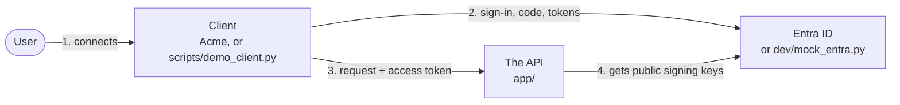
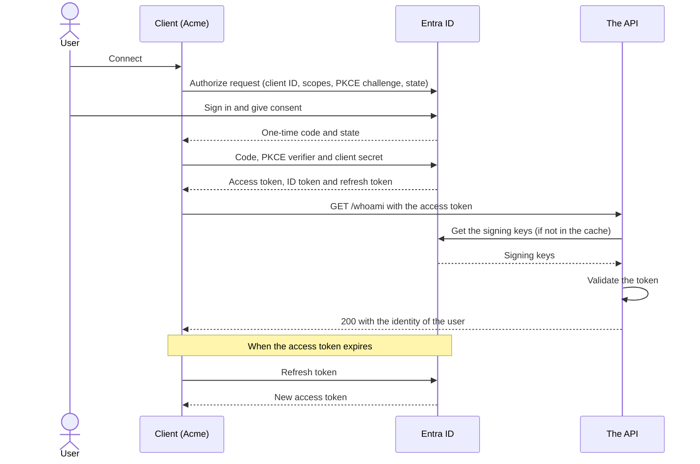
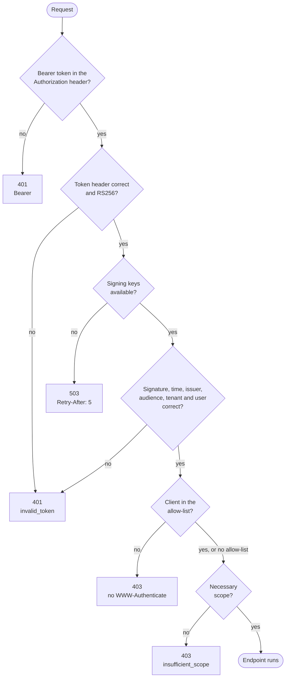
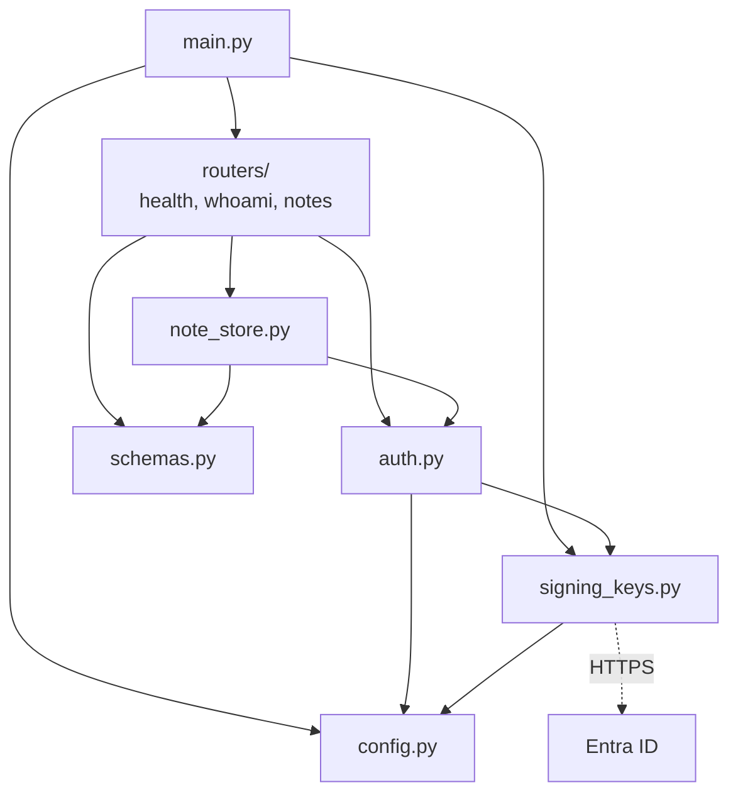

# Sample API protected by Entra ID

## 1. Purpose

This repository is a FastAPI sample. It shows how to protect an API with Entra ID.

An external platform can then call the API for a signed-in user. This document calls that platform **Acme**.

Use this repository to learn these items:

- How an API validates an access token from Entra ID.
- How an API checks the scope for each endpoint.
- Which status code the API must send for each failure.
- How a client gets a token and calls the API.

**NOTE:** You do not need an Entra ID tenant to run the sample. The repository contains a mock Entra ID.

### 1.1 Conventions

- "Must" shows a mandatory rule.
- "Can" shows an option.
- **CAUTION** shows a risk to security or to data.
- **NOTE** gives more information.

### 1.2 Key facts

- The API is an OAuth2 resource server. It does not sign in users. It does not receive passwords.
- Entra ID issues the tokens. The client sends the tokens. The API validates the tokens.
- The API has no secret. It uses the public signing keys of Entra ID only.
- The API identifies the user by the tenant ID and the object ID in the token.

### 1.3 Related documents

| Document | Contents |
|---|---|
| [docs/app-authorization.md](docs/app-authorization.md) | The design, the Entra ID setup procedure and the validation rules |
| [docs/acme-oauth2.md](docs/acme-oauth2.md) | How Acme uses OAuth2 |

## 2. How the system operates

### 2.1 Components



| Component | Function | In this repository |
|---|---|---|
| Entra ID | Signs in the user and issues tokens | `dev/mock_entra.py` replaces it for local runs |
| Client | Gets tokens and calls the API for the user | `scripts/demo_client.py` does the work of Acme |
| The API | Validates the token and sends the data | `app/` |

### 2.2 The sequence



- The messages before `GET /whoami` occur one time for each user.
- The messages from `GET /whoami` to the 200 response occur for each request.
- The API gets the signing keys only when its cache does not contain the necessary signing key.

### 2.3 How the API validates a request



**CAUTION:** Send 401 only when a new token can correct the problem. A client that receives 401 two times
disconnects the user.

### 2.4 Endpoints

| Endpoint | Necessary scope | Response |
|---|---|---|
| `GET /healthz` | None | `{"status": "ok"}` |
| `GET /whoami` | `Notes.Read` | The identity in the token |
| `GET /notes` | `Notes.Read` | The notes of the user |
| `POST /notes` | `Notes.ReadWrite` | The new note |

**NOTE:** The scope `Notes.ReadWrite` includes the scope `Notes.Read`.

The API also gives interactive documentation at `http://localhost:8000/docs`.

## 3. The codebase

### 3.1 Layout

```
 sample-auth-app/
 ├── app/                       the API
 │   ├── main.py                makes the FastAPI application and adds the routers
 │   ├── config.py              reads and validates the settings
 │   ├── auth.py                validates tokens and checks scopes
 │   ├── signing_keys.py        gets the signing keys with PyJWKClient
 │   ├── schemas.py             the request and response models
 │   ├── note_store.py          keeps the notes in memory
 │   └── routers/
 │       ├── health.py          GET /healthz
 │       ├── whoami.py          GET /whoami
 │       └── notes.py           GET /notes, POST /notes
 ├── dev/
 │   └── mock_entra.py          local replacement for Entra ID
 ├── scripts/
 │   └── demo_client.py         does the work of Acme
 ├── tests/                     automated tests
 ├── docs/                      design documents
 ├── README.md                  this document
 ├── .env.example               example settings
 ├── .gitignore                 files that you must not commit
 ├── pyproject.toml             dependencies and tool settings
 └── uv.lock                    the exact versions of the dependencies
```

### 3.2 How the modules relate



### 3.3 The path of a request through the code

This is the path of `POST /notes`:

1. `routers/notes.py` receives the request. The endpoint declares `WritePrincipalDep`.
2. FastAPI resolves `get_current_principal` in `auth.py`, with the scope that `WritePrincipalDep` declares.
3. `bearer_scheme` reads the `Authorization` header. If there is no bearer token, FastAPI sends 401.
4. `validate_access_token` reads the algorithm and the key ID (`kid`) from the token header.
5. `validate_access_token` refuses an algorithm that is not RS256.
6. `find_signing_key` in `signing_keys.py` gets the signing key for that key ID from `PyJWKClient`.
7. `validate_access_token` checks the signature and the claims. It gives a `Principal`.
8. `get_current_principal` checks the client allow-list.
9. `get_current_principal` checks the scope.
10. FastAPI validates the fields of the request body with `NoteCreateRequest`.
11. The endpoint saves the note in `NoteStore`, with the key `principal.user_key`.

If one of steps 3 to 9 fails, the API sends the status code from section 2.3. The endpoint does not run.

If step 10 fails, the API sends 422.

**NOTE:** FastAPI reads the JSON text of the body before step 2. If the body is not valid JSON, the API sends 422.
It does not check the token.

### 3.4 Patterns in the code

| Pattern | Where | Why |
|---|---|---|
| Dependencies with `Annotated` | `SettingsDep`, `JwkClientDep`, `NoteStoreDep` | The function signature shows what the function needs |
| Scopes with `Security` | `ReadPrincipalDep`, `WritePrincipalDep` | One line declares the scope that an endpoint needs |
| One router for each resource | `app/routers/` | Each file contains the endpoints of one resource |
| Pydantic models for input and output | `app/schemas.py` | FastAPI validates the data and writes the API documentation |
| Validated settings | `app/config.py`, `lifespan` in `app/main.py` | The API does not start with a setting that is not valid |
| Dependency overrides in tests | `tests/conftest.py` | The tests replace the settings and the note store. They use no network |

To protect a new endpoint, add one parameter:

```python
@router.get("/reports")
def list_reports(principal: ReadPrincipalDep) -> ReportListResponse: ...
```

Then do these steps:

1. Add the response model to `app/schemas.py`.
2. Make the router with `responses=AUTH_ERROR_RESPONSES`. The API documentation then shows the 401, 403 and 503
   responses.

To add a scope, add it to the `Scope` class in `app/auth.py`. Then make a dependency for it, with `Security`.

## 4. Procedures

### 4.1 Prerequisites

- Python 3.11 or later.
- [uv](https://docs.astral.sh/uv/).

### 4.2 Run the demo locally

The default settings use the mock Entra ID.

1. Install the dependencies.

   ```bash
   uv sync
   ```

2. Create the settings file.

   ```bash
   cp .env.example .env
   ```

3. Start the mock Entra ID in terminal 1.

   ```bash
   uv run fastapi dev dev/mock_entra.py --port 4050
   ```

4. Start the API in terminal 2.

   ```bash
   uv run fastapi dev
   ```

5. Run the demo client in terminal 3.

   ```bash
   uv run python scripts/demo_client.py
   ```

The demo client opens the browser. The mock Entra ID signs in a test user immediately. The demo client then shows
these results:

- The granted scopes and the identity of the user.
- The responses of `GET /whoami`, `POST /notes` and `GET /notes`.
- A 401 response for a request with no token.
- The response of `GET /whoami` after a token refresh.

To sign in as a different test user, add `--login-hint bob@example.com`. Each test user has their own notes.

If the computer has no browser, add `--no-browser`. Then request the printed URL from a different terminal:

```bash
curl -s -L "<URL>"
```

**NOTE:** The mock Entra ID makes a new signing key at each start. After you start it again, the API can send 401
for 30 seconds. Then the API gets the new signing key.

### 4.3 Run the tests

```bash
uv run pytest
```

The tests do not use the network. They sign their own tokens with a test key.

| Test file | Subject |
|---|---|
| `tests/test_health.py` | The health endpoint |
| `tests/test_token_validation.py` | Accepted tokens, refused tokens and the client allow-list |
| `tests/test_scopes_and_notes.py` | Scope checks and the notes of each user |
| `tests/test_signing_keys.py` | The signing keys: cache, rotation and failures |
| `tests/test_settings.py` | The settings, and the start of the API with settings that are not valid |
| `tests/test_mock_entra_flow.py` | The full flow: the mock Entra ID and the API together |

### 4.4 Format and examine the code

```bash
uv run ruff format .
uv run ruff check .
```

### 4.5 Use a real Entra ID tenant

1. Do the procedure in [docs/app-authorization.md](docs/app-authorization.md), section 5.
2. Open the file `.env`.
3. Set `TENANT_ID` to your tenant ID.
4. Set `API_CLIENT_ID` to the client ID of registration A.
5. Delete the `AUTHORITY_BASE_URL` line.
6. Set `DEMO_CLIENT_ID` to the client ID of registration B.
7. Set `DEMO_CLIENT_SECRET` to the client secret of registration B.
8. Start the API.
9. Run the demo client.
10. Sign in with an account of your tenant.

**NOTE:** Do not start the mock Entra ID for this procedure.

### 4.6 Share the repository

**CAUTION:** Do not share the file `.env`. Do not share the cache directories. They can contain paths from your
computer. The file `.gitignore` lists them.

## 5. Libraries

| Library | Where | Function |
|---|---|---|
| [FastAPI](https://fastapi.tiangolo.com/) | `app/`, `dev/` | The web framework, the dependency system and the scope declarations |
| [PyJWT](https://pyjwt.readthedocs.io/) | `app/`, `dev/`, `scripts/` | Checks the signature and the claims of a token. Its `PyJWKClient` class gets the signing keys |
| [pydantic-settings](https://docs.pydantic.dev/latest/concepts/pydantic_settings/) | `app/`, `dev/`, `scripts/` | Reads and validates the settings |
| [Authlib](https://docs.authlib.org/) | `scripts/`, `dev/` | Does the authorization code flow with PKCE, and the token refresh |
| httpx2 | `scripts/`, `tests/` | Sends the HTTP requests of the demo client and of the tests |
| [pytest](https://docs.pytest.org/) | `tests/` | Runs the automated tests |
| [Ruff](https://docs.astral.sh/ruff/) | Development | Formats and examines the code |

The API in `app/` needs FastAPI, PyJWT and pydantic-settings only.

Refer to [docs/app-authorization.md](docs/app-authorization.md), section 16, for alternative libraries.

## 6. Limits of the sample

- The notes stay in memory. A restart erases them.
- The sample accepts one tenant only.
- The sample does not include rate limits, logs or CORS.

**CAUTION:** Do not deploy `dev/mock_entra.py`. It is for development and demos only.
